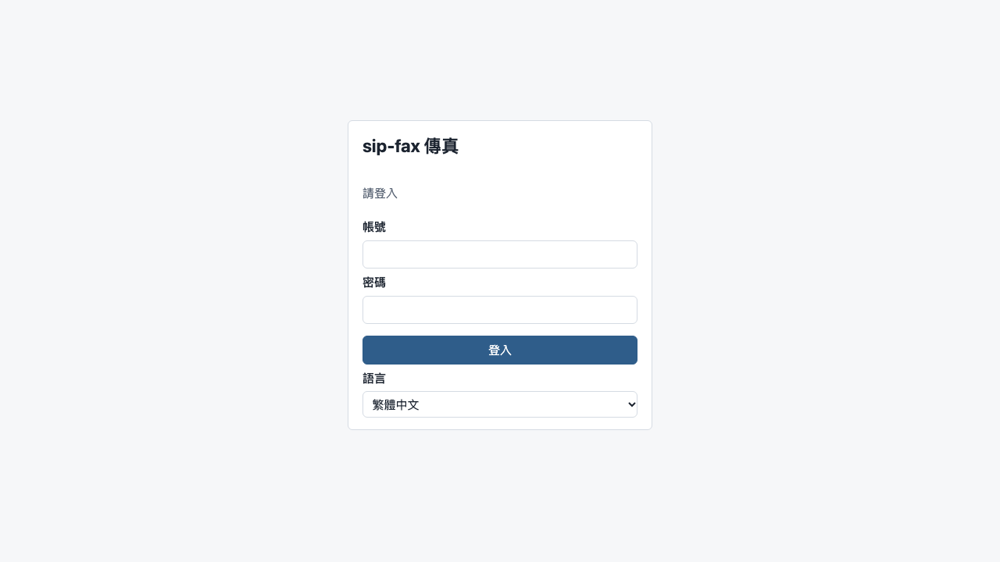
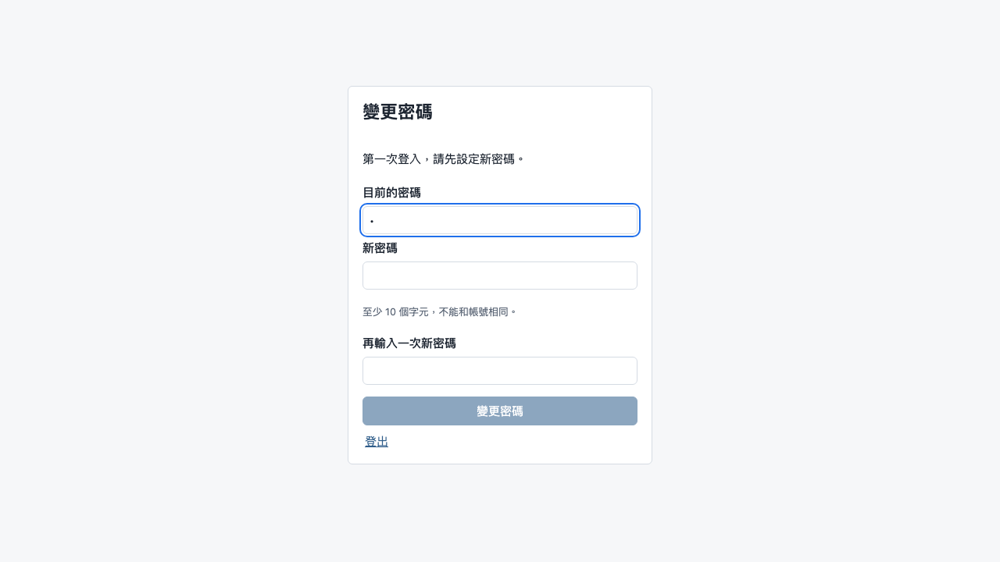
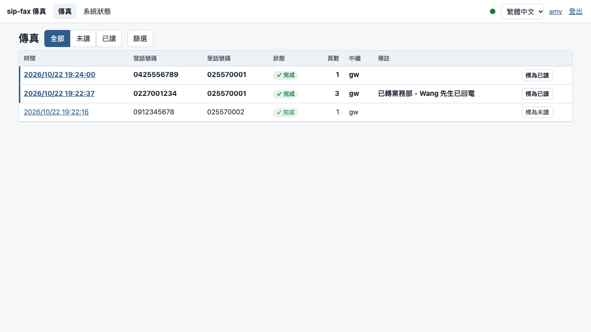
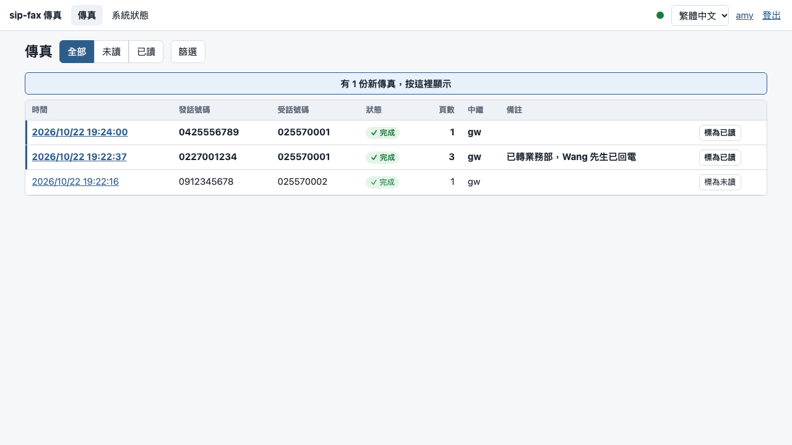
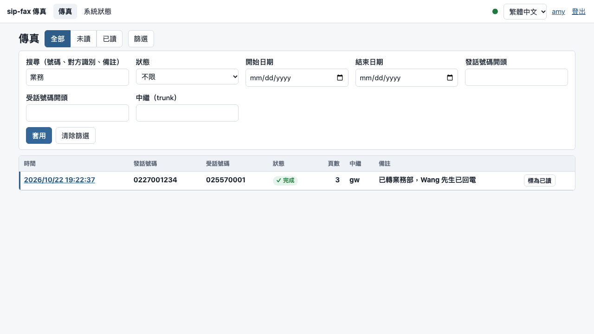
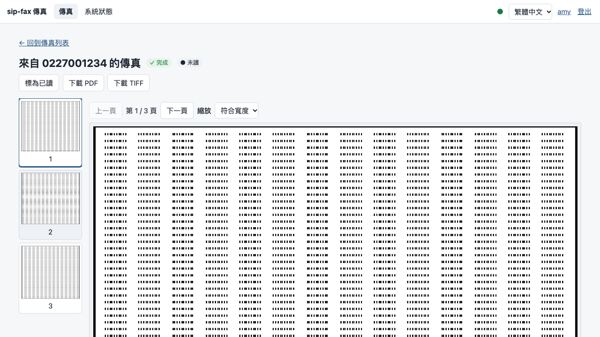
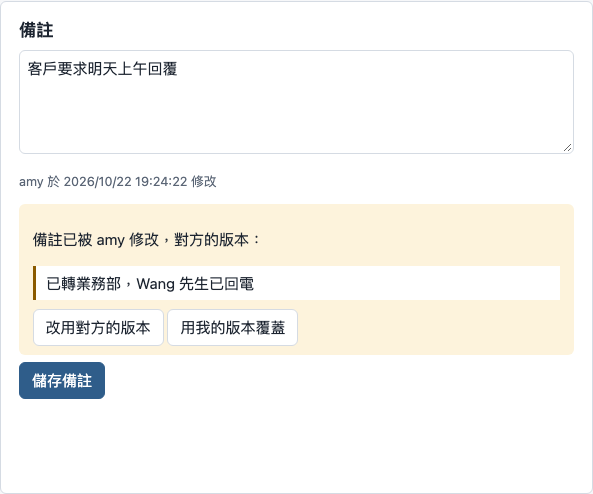

# sip-fax 座席使用手冊

適用版本：v0.3.0-alpha

這份手冊說明座席人員每天怎麼看傳真：登入、找傳真、看內容、標記已讀、寫備註、確認投遞。設定與帳號管理請見《IT 安裝維運手冊》（`it.md`）。

## 1. 登入

1. 以瀏覽器（Chrome、Edge、Firefox、Safari 的最新版本）開啟 IT 提供的網址，例如 `https://fax.example.local:8443/`。
2. 第一次連線時，瀏覽器可能顯示「連線不是私人連線」之類的警告。這是因為伺服器使用自簽憑證；請向 IT 確認後再繼續。
3. 輸入帳號與密碼，按「登入」。

**第一次登入**：系統會要求設定新密碼。新密碼至少 10 個字元，不能和帳號相同，兩次輸入要一致。

**注意**

- 連續輸錯密碼 5 次，帳號會鎖定 15 分鐘。
- 閒置 8 小時沒有操作，或登入滿 7 天，需要重新登入。
- 用完請按右上角的「登出」，特別是共用電腦。

## 2. 傳真列表

登入後看到的就是傳真列表，最新的在最上面。

| 欄位 | 說明 |
|---|---|
| 時間 | 來電時間（依你電腦的時區）。點時間可以開啟這份傳真。 |
| 發話號碼 | 對方的號碼；對方隱藏號碼時顯示「（未顯示號碼）」。 |
| 受話號碼 | 對方撥打的號碼（你們的傳真號碼）。 |
| 狀態 | 見下表。 |
| 頁數 | 收到的頁數。 |
| 中繼 | 從哪一條線路進來。 |
| 備註 | 備註的開頭。 |

**狀態**

| 狀態 | 意思 |
|---|---|
| ⟳ 接收中，第 N 頁 | 正在接收，會即時更新，不用重新整理。 |
| ✓ 完成 | 完整收到。 |
| ◐ 部分完成 | 對方中途掛斷或出錯，只收到部分頁面；已收到的頁面可以看。 |
| ✕ 失敗 | 沒有收到可用的傳真，例如通訊失敗。 |
| – 沒有傳真 | 接通了但不是傳真（例如一般電話撥錯）。 |

**未讀**的傳真以粗體顯示，左邊有一條色條。

**即時更新**：畫面右上角的圓點是即時連線狀態。實心表示已連線，新傳真會自動出現；空心表示連線中斷、正在重新連線，這時列表仍可使用，只是不會自動更新。

**有新傳真時**：如果你正在列表最上面，新傳真會直接出現在最上面。如果你往下捲動、或正在看別的頁面，新傳真不會打斷你，而是在上方出現「有 N 份新傳真，按這裡顯示」。

## 3. 找傳真

- **全部／未讀／已讀**：列表上方的三個按鈕，可以快速只看未讀的傳真。
- **篩選**：按「篩選」展開更多條件，設定後按「套用」；按「清除篩選」回到全部。

| 條件 | 說明 |
|---|---|
| 搜尋 | 在發話號碼、受話號碼、對方識別（傳真機的名稱）與備註中任何位置比對，不分大小寫。例如輸入「回電」可以找出備註裡有「回電」的傳真。 |
| 狀態 | 只看某一種狀態。 |
| 開始日期、結束日期 | 以整天計算（包含結束日期當天）。 |
| 發話號碼開頭、受話號碼開頭 | 例如「02」找台北的來電。 |
| 中繼 | 只看某一條線路。 |

往下捲動到底會自動載入更多；也可以按「載入更多」。

## 4. 看傳真內容

在列表點時間，開啟這份傳真。

- **換頁**：左邊是各頁縮圖，點縮圖換頁；也可以按「上一頁／下一頁」，或用鍵盤的左右方向鍵。
- **縮放**：「縮放」選單可以選「符合寬度」或 50%–200%，放大後可以捲動查看細節。
- **下載**：「下載 PDF」適合列印或轉寄；「下載 TIFF」是原始傳真格式。
- **詳細資料**：右側列出號碼、對方識別、時間、通話長度、頁數、結束原因等。傳真不完整時，「結束原因」會說明原因，例如「對方在傳真完成前掛斷」。
- 傳真檔案超過保存期限被清除後，頁面會顯示清除的日期，這時只剩紀錄，無法預覽或下載。

## 5. 已讀與未讀

**開啟傳真不會自動變成已讀。** 處理完畢後，請按「標為已讀」；要提醒自己或同事再看一次時，按「標為未讀」。

- 在列表上，每一列右邊也有「標為已讀／標為未讀」按鈕，不用開啟傳真就能切換。
- 誰在什麼時候改了已讀狀態，會顯示在傳真內容的詳細資料中。
- 其他人改了已讀狀態，你的畫面會自動更新。

## 6. 備註

在傳真內容頁下方的「備註」輸入文字（例如「已轉業務部」「請回電」），按「儲存備註」。

- 備註下方會顯示最後修改的人與時間。
- **兩個人同時修改**：如果在你輸入期間，別人先存了備註，你按儲存時會出現「備註已被 X 修改」，並顯示對方的版本。請選擇：
  - 「改用對方的版本」：放棄你的修改，改成對方的內容（可以再修改後儲存）。
  - 「用我的版本覆蓋」：以你的內容取代對方的。

- 你沒有在輸入時，別人存的備註會直接更新到你的畫面上。

## 7. 投遞狀態

如果系統設定了自動投遞（例如轉寄到 Email、存到共用資料夾），傳真內容頁下方的「投遞」會列出每個目的地：

| 狀態 | 意思 |
|---|---|
| 等待中 | 還沒送或正在送。 |
| 完成 | 已送達。 |
| 失敗（會重試） | 這次失敗，系統會自動再試（1、5、15、60 分鐘後，之後每 4 小時）。 |
| 已放棄 | 重試多次仍失敗。請通知管理員，管理員可以按「重新投遞」。 |

「最後的錯誤」欄位是給 IT 判斷原因用的。

## 8. 系統狀態

上方選單的「系統狀態」顯示服務是否正常、進行中的通話數，以及各線路的註冊狀態。傳真一直沒進來時，可以先看這裡，再通知 IT。

## 9. 語言與密碼

- **語言**：右上角的語言選單可以切換繁體中文／English，只影響這台電腦的瀏覽器。
- **我的帳號**：點右上角你的帳號名稱，可以把語言存到帳號（在任何電腦登入都使用），以及變更密碼。

## 10. 只用鍵盤操作

- 用 Tab 移到下一個項目、Shift+Tab 回上一個，Enter 開啟連結或按下按鈕。
- 在傳真內容頁，左右方向鍵換頁。

## 11. 終端機畫面（選用）

在伺服器上有帳號的人員，也可以用終端機畫面看傳真：執行 `sip-faxd tui`。

| 按鍵 | 動作 |
|---|---|
| ↑／↓（或 k／j） | 上下移動 |
| Tab／Shift+Tab | 切換區塊（傳真、進行中的通話、狀態） |
| Enter | 開啟傳真的詳細資料 |
| u | 只看未讀／全部 |
| r | 切換已讀 |
| n | 編輯備註（Enter 儲存、Esc 取消） |
| Esc | 關閉詳細資料 |
| q | 離開 |

## 12. 常見問題

| 狀況 | 怎麼辦 |
|---|---|
| 登入時顯示「帳號或密碼錯誤」 | 確認大小寫與輸入法；忘記密碼請找管理員重設。 |
| 顯示「登入失敗太多次」 | 等 15 分鐘再試，或請管理員協助。 |
| 右上角圓點一直是空心 | 即時更新中斷；列表仍可用，重新整理頁面試試看，持續發生請通知 IT。 |
| 傳真狀態是「部分完成」 | 請對方重傳；已收到的頁面仍可查看。 |
| 預覽一片空白或很慢 | 第一次開啟舊傳真時系統需要轉檔，稍等幾秒；仍不行請下載 PDF。 |
| 找不到某份傳真 | 檢查上方是否選了「未讀／已讀」或有篩選條件，按「清除篩選」。 |
